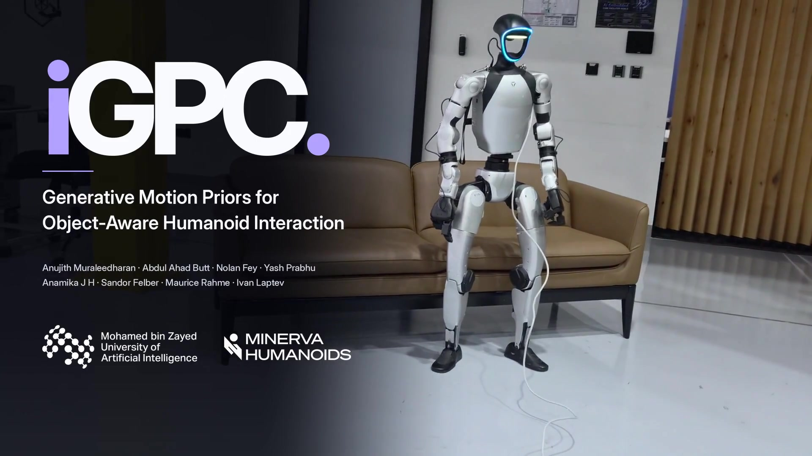

# iGPC: Generative Motion Priors for Object-Aware Humanoid Interaction

Anujith Muraleedharan · Abdul Ahad Butt · Nolan Fey · Yash Prabhu · Anamika J H · Sandor Felber · Maurice Rahme · Ivan Laptev

[Project page](https://anujithm.github.io/iGPC/) · [Paper (arXiv)](https://arxiv.org/abs/2610.08120) · [Project film](https://anujithm.github.io/iGPC/#project-film)

[](https://anujithm.github.io/iGPC/#project-film)

iGPC adapts a pretrained human-motion controller to interact with objects. In simulation, experts learn where to reach, when to brace against a rail, and how to keep a box moving. A student learns from those experts using depth, LiDAR, and proprioception to deploy on unitree G1.

## Citation

```bibtex
@misc{muraleedharan2026igpc,
  title         = {{iGPC}: Generative Motion Priors for Object-Aware Humanoid Interaction},
  author        = {Anujith Muraleedharan and Abdul Ahad Butt and Nolan Fey and
                   Yash Prabhu and Anamika J H and Sandor Felber and
                   Maurice Rahme and Ivan Laptev},
  year          = {2026},
  eprint        = {2610.08120},
  archivePrefix = {arXiv},
  primaryClass  = {cs.RO},
  doi           = {10.48550/arXiv.2610.08120},
  url           = {https://arxiv.org/abs/2610.08120}
}
```

## Acknowledgments

We thank the teams behind [SuperMimic](https://github.com/HybridRobotics/supermimic), [GPC](https://xbpeng.github.io/projects/GPC/), [ProtoMotions](https://github.com/NVlabs/ProtoMotions), and [SONIC](https://github.com/NVlabs/GR00T-WholeBodyControl) for sharing their research and open-source tools.
